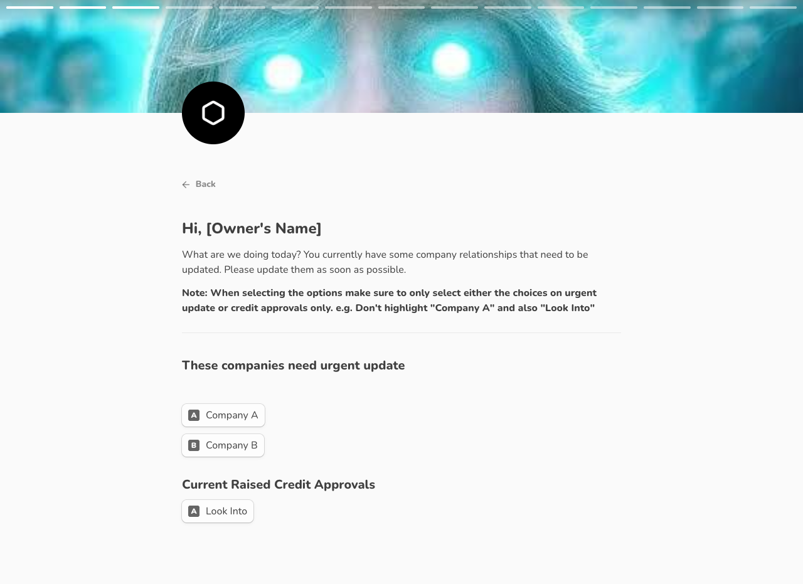

# Tony's chatbot questionnaire (Tally form): content, routing and review notes

For the team meeting on 21 October 2026 at 1 pm Sydney time.

- **Form:** "Chatbot Questionnaire Scenario", https://tally.so/r/aONb6W
- **Inspected:** 21 October 2026 (early morning, Sydney time), as an anonymous visitor, using test inputs only.
- **What this is:** a Tally form built to look like a chatbot conversation. It is a mock-up of a possible flow. It is **not** evidence of what a working AI chatbot can do, and the form says so itself.
- **Nothing was submitted.** No response or completed entry was created. The form was not changed and Tony was not contacted.

## How this was checked

The form was checked in two ways:

1. **Published form data.** The public page contains the form's own definition: every block of text, every question and option, the required flags and all 27 logic rules. All wording below is copied from that data and matches what the browser showed. Each page's internal name (for example "Owner Route") also comes from this data. Respondents never see these names.
2. **Browser walkthrough.** I clicked through every branch I could reach without submitting, and checked validation, button labels and Back behaviour.

Each route is marked as one of:

- **Observed:** I took this path in the browser and saw the result.
- **From rules:** the path is defined in the published logic, but I did not take it in the browser.
- **Not reached:** see [Gaps](#gaps-and-limits).

Page numbers are the form's own progress bar numbers ("Page N of 18").

---

## Part 1: Content, page by page

The wording is reproduced exactly, typos included. In Tally, **bold** and _italic_ are formatting. Square-bracket placeholders such as `[Company #]` appear literally on screen; the form never fills them in.

Unless noted otherwise, every choice question is single-select: clicking an option selects it, and clicking it again clears it. Each option shows a letter key (A, B, …). An asterisk (*) marks a required question.

### Page 1: Introduction
Internal name: none. Button: **Let's Start**.

> # Chatbot Questionnaire Scenario
>
> _**Instructions:** This is an example questionnaire that an owner or employee will get when making credit decisions based on a simulated chatbot. This is done in an interactive site (form) that models what a conversation may look like. You can flick through each page to simulate what it might look like as one of the employees/owner. This is not final and only shows specific scenarios._
>
> **A couple of notes made:**
>
> \* This acts as an interface with sample chatbot responses, it is quite limited on what It can do since it is a form.
>
> \* Its not possible for the form to capture abstract concepts like emotion, if an owner states that I feel this company will go bankrupt, the owner can only put Yes/No. It won't be able to interpret meaning from short answer forms.
>
> \* If you were looking for questionnaire based questions, you can use the headings of each page. However, do note this is acting more of a conversation flow, then questionnaire.
>
> \* Some of the responses are assumed that the AI chatbot knows and is trained on a dataset to provide certain responses.

### Page 2: Role selection
Internal name: none. Button: **Next**.

> ## Select Which Role You Are
>
> **Which Role Are You?** *
> - A. Owner
> - B. Employee

### Owner route

#### Page 3: Owner menu
Internal name: "Owner Route". The two questions are separate and neither is required.

> ## Hi, [Owner's Name]
>
> What are we doing today? You currently have some company relationships that need to be updated. Please update them as soon as possible.
>
> **Note: When selecting the options make sure to only select either the choices on urgent update or credit approvals only. e.g. Don't highlight "Company A" and also "Look Into"**
>
> ---
>
> **These companies need urgent update**
> - A. Company A
> - B. Company B
>
> **Current Raised Credit Approvals**
> - A. Look Into

Until something is selected, the page shows **no Next button** (screenshot below), so the only way out is Back.



#### Page 4: Relationship check
Internal name: "Owner Route 2".

> ### You've last updated this relationship on the [A month ago], we need to confirm a couple of questions with you.
>
> Previously, you've stated that [Company #] is trusted and pays their credit on time. Is this still the case?
>
> **Does this company still pay their credit?** *
> - A. Yes
> - B. No
>
> **Does this company pay on time?** *
> - A. Yes
> - B. No

#### Page 5: Approve despite problems?
Internal name: "Owner No".

> ### You've mentioned that this company does not pay their credit on [time/over limit], would you still approve their transaction?
>
> This will update the system accordingly and make future decisions on your behalf. Regarding [Company #],
>
> **Would you approve over the credit limit?** *
> - A. Yes
> - B. No
>
> **Would you allow payments past the due date?** *
> - A. Yes
> - B. No

#### Page 6 and Page 8: Reasoning and signature
Internal names: "Owner No Block" (page 6) and "Owner Yes" (page 8). Both pages have identical content:

> **Please explain the reasoning on why you've made this decision.** *
> _(multi-line text box, no placeholder)_
>
> **Please Sign Here** *
> _(drawn signature box, with a Clear button once drawn)_

#### Page 7: Owner checkpoint
Internal name: "Owner YES/NO Checkpoint".

> ### You've now updated [Company #], your responses will now make deliberate actions for future credit decisions from this company.
>
> Moving forward, [Company #] will be allowed/disallowed transactions with the business as you've stated that they are on good financial terms with you. The employee decisions will be based on what you've answered here.
>
> Remember that you can always update your relationships.
>
> **What Now?** *
> - A. Return to Updating
> - B. Finalise Session

#### Page 9: Choose a raised credit approval
Internal name: "Raised Credit Approvals Page". The dropdown is not required.

> **Select A Credit Approval**
> _(dropdown)_
> - Company E credit limit
> - Company G overdue
> - Company B credit limit
> - Company K overdue

#### Page 10: Over the credit limit
Internal name: "Credit over Limit".

> ### [Company #] is over the credit limit by [Sum Amount], and is requesting another transaction. Would you approve?
>
> [Explanation: This choice also confirms quickly whether to approve a transaction, basically what the business is already doing right now, an AI model can potentially use this response to make the decisions]
>
> **Approve?** *
> - A. Yes
> - B. No

#### Page 11: Overdue payment
Internal name: "Credit Not On Time".

> ### [Company #] is overdue for payment by [This Date], and is requesting extra time. Would you approve?
>
> **Approve?** *
> - A. Yes
> - B. No

#### Page 12: Credit approval checkpoint
Internal name: "Credit/Time Checkpoint".

> ### You've now updated [Company #], your responses will now make deliberate actions for future credit decisions from this company.
>
> This has been updated within the system, employees will now recieve your decision regarding this company.
>
> **What Now?** *
> - A. Return to Updating
> - B. Finalise Session

### Employee route

#### Page 13: Employee menu
Internal name: "Employee Route".

> ### Hi There, How Can I Help?
>
> If you are enquiring about a credit decision regarding credit limit or overdue payment, select the options below. If you would like to understand the current company relationship and make your decision, please select the first option.
>
> **Enquire** *
> - A. Company Relationship List
> - B. Escalate Decision To Owner

#### Page 14: Choose a company
Internal name: "Employee RL".

> ### Please Choose The Company That You're Looking For,
>
> For certain companies, some are on good terms and some are not. If your request is from one of these companies, select them.
>
> **Select A Company** *
> _(dropdown)_
> - Company A
> - Company B
> - Company C
> - Company D
> - Company E (Bad Standing)
> - Company F (Bad Standing)
> - Company G

#### Page 15: Good standing recommendation
Internal name: "Good Standing". The Escalate option is not required.

> ### Company A/B/C/D/G
>
> According to the relationships and their tendency to pay their credit even past policy rules, this company should be offered additional time/credit limit as they are on good standing with the business. You should **ACCEPT** the transaction/request.
>
> **If you believe this decision is wrong, you can escalate this to the owner**
> - A. Escalate

#### Page 16: Bad standing recommendation
Internal name: "Bad Standing". The Escalate option is not required.

> ### Company E/F
>
> Regarding the recent overdue payment that has been request on the 21/10/2025, the payment has still not arrived. If the company is looking for any transaction, you should **DECLINE** the transaction.
>
> **If you believe this decision is wrong, you can escalate this to the owner**
> - A. Escalate

#### Page 17: Escalation to the owner
Internal name: "Employee EDTO". Button: **Submit**.

> ### You are in the process of raising a approval concern to the owner.
>
> If you are unsure of the decision to make for either approval or denial of a request by [Company #] that violates the company's policies. Please raise a request below.
>
> Please note that the request should have been confirmed through the current relationship list and if the decision is inappropriate then submitting a request is the best option.
>
> **Please Mention The Company Name, Request Type and Employee ID.** *
> _(multi-line text box, no placeholder)_

### Page 18: Ending (thank-you page)
Internal name: "Session End". This is Tally's thank-you page, so reaching it means the response has been submitted. **Not viewed**; the text comes from the published data:

> # Thank you for interacting with our chatbot. 😊

---

## Part 2: Routing

### Flow overview

```
1 Intro ──► 2 Role
             ├─ Owner ──► 3 Owner menu
             │             ├─ Company A / Company B ──► 4 Relationship check
             │             │     ├─ both Yes ──► 8 Reasoning + signature ──► 7 Checkpoint
             │             │     └─ any No  ──► 5 Approve despite problems?
             │             │            ├─ past due = Yes ──► 7 Checkpoint   (skips reasoning; see R5)
             │             │            └─ past due = No  ──► 6 Reasoning + signature ──► 7 Checkpoint
             │             └─ Look Into ──► 9 Choose credit approval
             │                   ├─ "credit limit" items (or none) ──► 10 Over limit ──► 12 Checkpoint
             │                   └─ "overdue" items ──► 11 Overdue ──► 12 Checkpoint
             │       7 / 12 Checkpoint:  Return to Updating ──► 3   |   Finalise Session ──► SUBMIT ──► 18
             └─ Employee ──► 13 Employee menu
                           ├─ Company Relationship List ──► 14 Choose company
                           │     ├─ A/B/C/D/G ──► 15 "ACCEPT"
                           │     └─ E/F       ──► 16 "DECLINE"
                           │           15 / 16:  Escalate ──► 17   |   no escalation ──► SUBMIT ──► 18
                           └─ Escalate Decision To Owner ──► 17 Escalation text ──► SUBMIT ──► 18
```

### Rule by rule

| # | Page | Answer | Goes to | Evidence |
|---|---|---|---|---|
| R1 | 2 | Owner | 3 | Observed |
| R1 | 2 | Employee | 13 | Observed |
| R2 | 3 | Nothing selected | Next button hidden; respondent cannot continue | Observed |
| R2 | 3 | Company A | 4 | Observed |
| R2 | 3 | Company B | 4. Company B has no rule of its own, so it falls through to the next page | From rules (not clicked) |
| R2 | 3 | Look Into only | 9 | Observed |
| R2 | 3 | Company A **and** Look Into (the note says not to) | 9. Both are allowed and Look Into wins | Observed |
| R3 | 4 | Yes and Yes | 8 | Observed |
| R3 | 4 | Either answer No | 5 | Observed (pay on time = No) |
| R4 | 5 | Over limit No, past due No | 6 | Observed |
| R5 | 5 | Over limit No, past due Yes | 7, **skipping the reasoning and signature page** | Observed |
| R5 | 5 | Over limit Yes, past due Yes | 7 | From rules |
| R4 | 5 | Over limit Yes, past due No | 6 | From rules |
| R6 | 6 and 8 | Reasoning filled and signature drawn | 7 | From rules (see Gaps) |
| R7 | 7 and 12 | Return to Updating | 3, with earlier selections still ticked | Observed from page 12; page 7 has the same rule |
| R7 | 7 and 12 | Finalise Session | Button changes to **Submit**, which submits and shows page 18 | Label observed on page 12; not clicked |
| R8 | 9 | Company E or Company B credit limit | 10 | From rules |
| R8 | 9 | Company G or Company K overdue | 11 | Observed (Company G) |
| R8 | 9 | Nothing selected | 10 (falls through) | Observed |
| R9 | 10 and 11 | Yes or No | 12 | Observed (page 10, Yes); page 11 from rules |
| R10 | 13 | Company Relationship List | 14 | Observed |
| R10 | 13 | Escalate Decision To Owner | 17 | Observed |
| R11 | 14 | Company A, B, C, D or G | 15 | Observed (Company A) |
| R11 | 14 | Company E or F | 16 | Observed (Company E) |
| R12 | 15 and 16 | Escalate | 17 | Observed from page 15; page 16 from rules |
| R12 | 15 and 16 | Not ticked | Button shows **Submit**, which submits and shows page 18 | Label observed on both pages; not clicked |
| R13 | 17 | Text entered | **Submit**, which shows page 18 | Label observed; not clicked |

### Rule problems in the published logic

These are worth checking with Tony, not judging. Each could be deliberate or an editing slip.

- **R5, duplicated condition.** On page 5, the rule that skips the reasoning page checks "Would you allow payments past the due date? = Yes" twice. It never checks the credit-limit answer. As a result, an owner who answers **No** to over-limit and **Yes** to past-due goes straight to "You've now updated…" without being asked to give reasons or sign (observed). The second check was presumably meant to be the credit-limit question.
- **R4, "show blocks" with no visible effect.** The page 5 rule that fires on any No tries to show page 6, which is never hidden. Page 6 is reached anyway because it is the next page.
- **R10, empty action.** The "Company Relationship List" rule on page 13 has an action with no type. It works only because page 14 is the next page anyway.
- **R2, empty condition.** The page 3 rule includes "urgent update is empty → page 4" (meaning "Look Into only"). That rule is then overridden by the Look Into rule, which is why the on-page note warns against selecting both.

---

## Part 3: Required fields, validation and navigation

- **Required fields** are marked * (see Part 1). Clicking Next with a required question unanswered keeps you on the page and shows "Please select an option" for choices (observed on pages 2 and 14) or "Please sign" for the signature (observed on page 8). An empty textarea was not tested on its own.
- **Optional fields:** page 3 (both questions), page 9 (dropdown), and Escalate on pages 15 and 16.
- **The signature** is drawn with a mouse or finger in a box. A Clear button appears once something is drawn.
- **Button labels change with the answers.** The button says **Next** when the next page is a question page and **Submit** when the next page is the thank-you page. On pages 15 and 16 that makes "do nothing" the same as submitting.
- **Back** follows the path you actually took, not page order. For example, page 11 → Back → page 9 → Back → page 3 (observed).
- **The progress bar** reads "Page N of 18", counting every page in the form. Because the form branches, it jumps around: an employee goes from "Page 2 of 18" to "Page 13 of 18".
- **Save for later is on.** Answers are kept in the visitor's browser (local storage). Reloading the page shows the introduction again, with answers still stored locally. Leaving mid-form triggers the browser's "leave this page?" warning (observed).
- **Partial responses are off** in the form settings, so answers reach Tony only on Submit. Tally does record anonymous activity events as each question is answered. The one event I inspected contained a session ID and question ID but no answer. Tony's Tally analytics may therefore show an unfinished visit from this inspection.
- **Placeholders are never filled in.** Values such as `[Company #]` stay as literal text even after a specific company is chosen (observed after choosing Company A).

## Gaps and limits

- **Page 18 (the thank-you page)** was not opened. Reaching it requires a submission. Its one line of text comes from the published data.
- **Leaving pages 6 and 8.** I filled the reasoning box and drew a signature on page 8, but the browser safety check blocked advancing after signing, and I did not work around it. The routes from pages 6 and 8 to page 7 come from the rules only. Page 7's content was observed by another route (R5).
- **Paths from rules only:** Company B on page 3; Yes/Yes and Yes/No on page 5; Company E, B and K on page 9; page 11's answers; page 7's own buttons; Escalate from page 16. All follow the same patterns as the observed paths.
- **No real data exists in the form.** Companies A–G and K, amounts and dates are placeholders or fictional, and no external data is looked up.

---

## Part 4: Assessment (separate from the factual record above)

**Short answer:** the form mainly walks the respondent through a predetermined approval workflow. It captures very little of the owner's needs or reasoning, and what it does capture is mostly unstructured.

**What it does well**
- It makes the approval moments explicit: the owner confirms, gives reasons and signs; the employee receives a recommendation and can escalate to the owner. That is the kind of human-approval step the course's agentic requirement asks for.
- It is honest about its limits. The introduction says it is a form, cannot interpret meaning and shows only specific scenarios.

**Where it falls short of capturing needs and reasoning**
- **Almost every input is Yes/No or a pick from a list the system provides.** The system decides which companies need attention and what the employee should do (**ACCEPT** or **DECLINE**). The respondent mostly confirms.
- **Reasoning is collected in only two places**, both as free text: pages 6/8 (owner) and page 17 (employee). It is skipped on the whole credit-approval path (pages 9–12). Because of R5, it is also skipped on one exception path.
- **It does not ask what drives the owner's decision.** Examples: how far over the limit is acceptable, how many days overdue, which customers are exceptions, what history matters, or who else may approve. Those are the questions the 15 October meeting note describes as Tony's deliverable: "the questions a future chatbot asks the owner, supported by research" (action A08). The introduction suggests reading the page headings as the questions, but most headings are statements or yes/no prompts.
- **One answer becomes a standing rule.** Text such as "make future decisions on your behalf" and "The employee decisions will be based on what you've answered here" turns a single yes/no into a permanent policy for that company. The project's AGENTS.md says not to turn a one-off decision into a reusable rule without the owner's stated scope and authority. The form never asks the owner for that scope.
- **The page 7 message is the same whatever the owner chose.** It says "allowed/disallowed … as you've stated that they are on good financial terms with you", even after the owner has said the company does not pay on time.
- **It does not ask about needs at all.** Nothing asks how long approvals take today, what is painful about them, or what the owner would or would not trust a system to do.

**Questions to raise at the meeting**
1. Is this meant as a flow mock-up, as the question set for A08, or both? If both, the question set probably needs its own list.
2. Should the owner's decision on pages 5, 10 and 11 apply once, to this company from now on, or to a stated threshold? And should the form ask which?
3. Is R5 (skipping the reasons when past-due is Yes) intended?
4. Are the fictional companies meant to match across routes? For example, Company K appears in the owner's approval list but not in the employee's relationship list.
5. Is the 21/10/2025 date on page 16 intentional? It is one year before today.
